# Surakshit Bharat — A Centralized Emergency Response System for India

**A unified platform designed to help people connect with emergency services through chat, calls, location sharing, multimedia, and AI-assisted first-aid guidance.**

- **Live Demo:** https://mangesh2704.github.io/Surakshit-Bharat-A-Centralized-Emergency-Response-System-for-India/
- **GitHub Repository:** https://github.com/Mangesh2704/Surakshit-Bharat-A-Centralized-Emergency-Response-System-for-India

---

## Introduction


**Surakshit Bharat** is a web-based centralized emergency response system developed as a major project by students of the Information Technology Department at Xavier Institute of Engineering, University of Mumbai. It aims to simplify access to emergency assistance by bringing communication and emergency-support features together in one platform.

During an emergency, people may not know which helpline to contact or may be unable to make a voice call. Surakshit Bharat is designed to support multiple communication methods, share the user's location and images, and provide AI-assisted first-aid guidance while help is being sought.

The project was initially scoped around Mumbai and its suburbs, with the concept designed to be extendable to other regions.

> **Important safety notice:** This is an academic project/demo, not an official emergency dispatch service. Do not rely on it for real emergencies. Contact the appropriate official emergency service directly if you need urgent help. Chatbot responses are not a substitute for professional medical advice.

## Problem Definition

Emergency assistance can involve different services, contact numbers, and communication channels. In stressful situations, identifying the right service and explaining the situation can take valuable time. Communication may also be difficult when speaking aloud is unsafe or impossible.

Surakshit Bharat explores a single interface for reaching relevant emergency-service contacts, communicating by text or call, and sharing useful situational information such as location and images.

## Key Features

- **Centralized emergency access:** A common platform for accessing relevant emergency-service contacts, such as police, fire, and ambulance services.
- **Panic button:** An emergency-oriented entry point for initiating assistance and exploring available response options.
- **Chat-based communication:** Real-time messaging between users and emergency-service/provider accounts.
- **Emergency calling:** Calling functionality integrated with Twilio.
- **Location sharing:** Shares the user's geographic coordinates to help communicate where assistance may be needed.
- **Nearby service connection:** Supports connecting users with a nearby service/provider according to available location and service data.
- **Image and multimedia sharing:** Users can capture or select images and share them through the interface; media storage uses Cloudinary.
- **AI-assisted chatbot:** Offers general first-aid information and emergency-related guidance while users seek professional assistance.
- **User authentication:** Registration/login flow with phone OTP and email verification in the intended workflow.
- **Chat history:** Stores and retrieves messages for conversations.
- **Responsive interface:** Designed for desktop and mobile screens.
- **Emergency information and contact sections:** Helps users explore the project and its intended services.

*Availability of individual features depends on the demo deployment and the external service configuration.*

## images/screenshots

The following images/screenshots are from the project's major-project report materials.

### Landing page

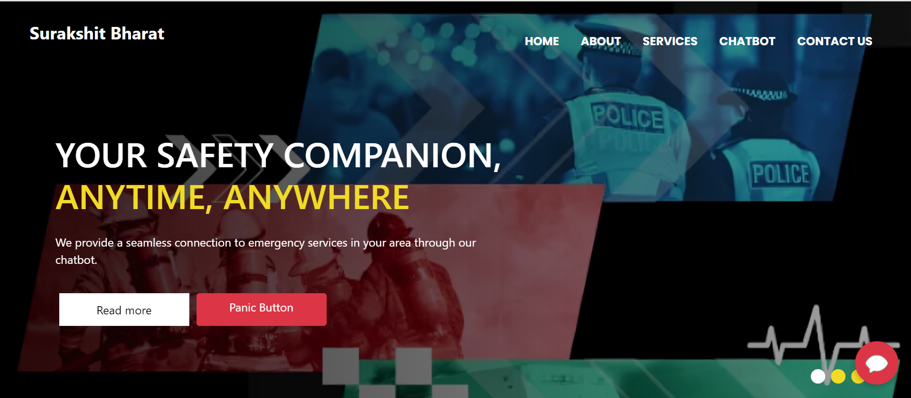

### AI-assisted chatbot

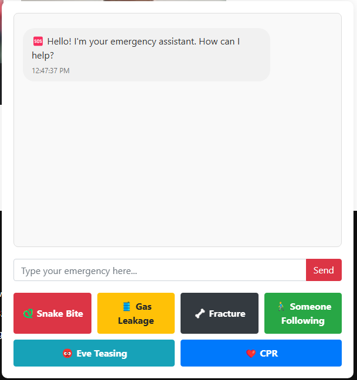

### Login page

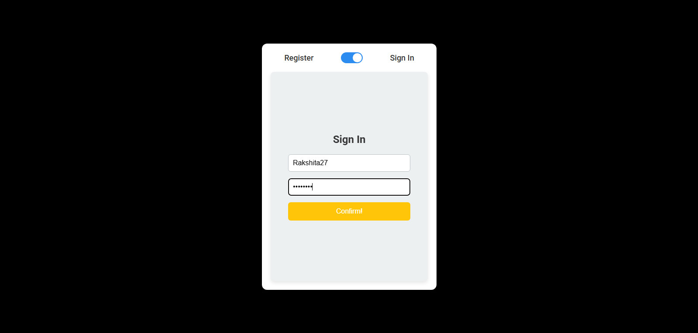

### Emergency chat interface

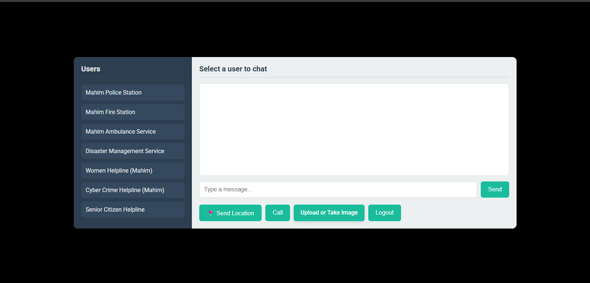

### Location sharing

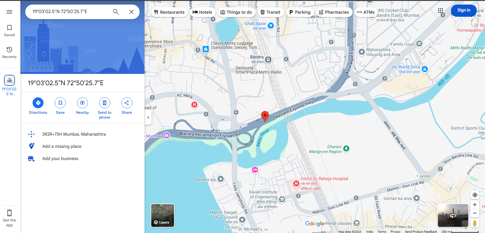

### Mobile interface

The mobile images/screenshots are presented inside phone-outline frames to show how the interface appears on smaller screens.

| Mobile view 1 | Mobile view 2 | Mobile view 3 |
|:---:|:---:|:---:|
| 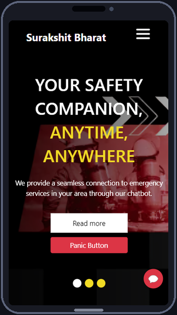 | 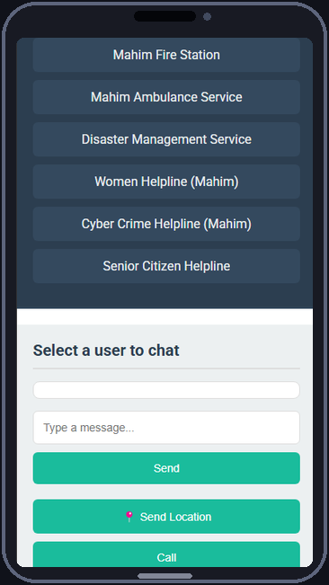 | 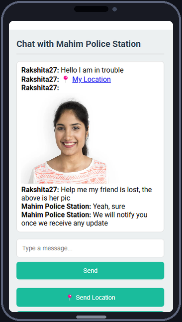 |

## System Architecture

The frontend is built with HTML, CSS, JavaScript, and Bootstrap. The Node.js/Express backend handles server-side logic, authentication, service/provider data, and API requests. Socket.IO supports real-time chat. MongoDB Atlas stores application data, while Cloudinary stores image/media assets. External integrations include Twilio for calling/communication, an SMTP service for email, and the APIs configured for chatbot and location functionality.

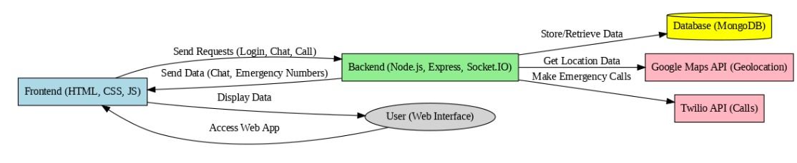

### Proposed workflow

1. The user opens the web application and signs in.
2. The user selects an emergency service or starts an emergency interaction.
3. The application can initiate a chat or call based on the available options.
4. The user's location can be shared to provide context to the service/provider.
5. Text messages and supported media are exchanged through the application.
6. The chatbot can provide general first-aid information while the user seeks appropriate help.

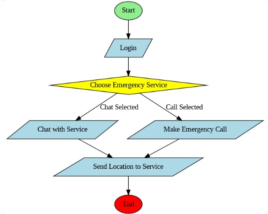

### Database design

The report's data model includes users, emergency services, chats, messages, and location records. A user may have multiple chats, each chat can contain multiple messages, and location records can be associated with a user.

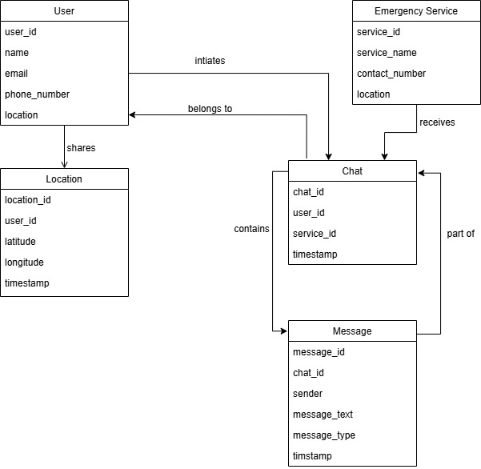

## Technology Stack

| Component | Technologies / Services |
|---|---|
| Frontend | HTML5, CSS3, JavaScript, Bootstrap |
| Backend | Node.js, Express.js |
| Real-time communication | Socket.IO / WebSockets |
| Database | MongoDB Atlas |
| Media storage | Cloudinary |
| Calling / communication integration | Twilio |
| Email verification / email delivery | SMTP service |
| Chatbot | AI API integration as configured in the project |
| Location | Browser geolocation and configured map/location API |
| Version control | Git and GitHub |
| Deployment | GitHub Pages (frontend demo), backend hosted separately when configured |

## Repository Structure

The frontend and backend are maintained in **separate Git branches**. Download or clone the repository and switch to the relevant branch to obtain each part.

The backend entry point is `server.js`. The frontend is a static web interface that can be opened using `index.html` or served through Visual Studio Code's Live Server extension.

```text
Surakshit-Bharat/
├── frontend branch
│   ├── index.html
│   ├── CSS / JavaScript / assets
│   └── frontend configuration (.env, where used)
└── backend branch
    ├── server.js
    ├── routes / models / middleware
    └── backend configuration (.env)
```

*This is a high-level guide; exact folders and filenames may vary by branch.*

## Prerequisites

Install or prepare the following before running the complete application:

- [Node.js](https://nodejs.org/) and npm
- [MongoDB Atlas](https://www.mongodb.com/atlas) account and database connection string
- [Cloudinary](https://cloudinary.com/) account for media storage
- A Twilio account and the credentials/phone configuration required by the calling features
- SMTP credentials for email-related functionality
- The AI/chatbot and map/location API credentials required by the version of the project you are running
- [Visual Studio Code](https://code.visualstudio.com/) and the Live Server extension (recommended for the frontend)

## Setup and Installation

### 1. Get the repository

Open the [GitHub repository](https://github.com/Mangesh2704/Surakshit-Bharat-A-Centralized-Emergency-Response-System-for-India). Download the frontend and backend from their respective branches, or clone the repository and check out each branch separately.

```bash
git clone https://github.com/Mangesh2704/Surakshit-Bharat-A-Centralized-Emergency-Response-System-for-India.git
cd Surakshit-Bharat-A-Centralized-Emergency-Response-System-for-India
git branch -a
```

If the frontend and backend are separate branches, switch to and download each branch individually using the branch names shown by `git branch -a`.

### 2. Configure environment variables

Create/configure the `.env` files expected by the project. Add your own credentials; **never commit real secrets to GitHub**.

- **Frontend `.env` / frontend configuration:** Twilio settings used by the frontend, as required by the current implementation.
- **Backend `.env`:** MongoDB Atlas connection details, Cloudinary credentials, SMTP/email settings, and any other backend API keys required by the code.

Use the exact variable names expected by the project's source code. Do not copy credentials from someone else's account. If a credential is exposed publicly, revoke or rotate it.

> Static HTML pages do not automatically load `.env` files in the same way as a Node.js server or a frontend build tool. If the frontend uses a configuration script, update that configuration according to the project's implementation. Do not put private Twilio auth tokens or other server secrets in browser-accessible JavaScript.

### 3. Start the backend

Open a terminal in the **backend branch/folder**. Install dependencies if a `package.json` is present, then start the server:

```bash
npm install
node server.js
```

The backend will start on the port configured in the project. Check the terminal output and the backend configuration for the correct local URL/port.

### 4. Start the frontend

Open the **frontend branch/folder**.

- Open `index.html` in your browser, or
- In Visual Studio Code, right-click `index.html` and choose **Open with Live Server** (recommended).

If the frontend calls a locally running backend, make sure its API/base URL points to the backend address and port shown in the server configuration. Keep the backend running while testing frontend features that depend on it.

## Live Demo

Explore the deployed website:

**[Surakshit Bharat — Live Demo](https://mangesh2704.github.io/Surakshit-Bharat-A-Centralized-Emergency-Response-System-for-India/)**

### Demo access and current limitations

- The registration service is currently not working in the deployed demo. Go directly to **Sign In** to explore the available interface.
- The demo login details shared for this project are:
  - **Username:** `Mangesh27`
  - **Password:** `abc123de`
- After signing in, you can explore the website and try the **Panic** button to inspect the emergency workflow.

**Please use the demo only for exploration.** Do not submit real emergency reports, personal information, private images, or sensitive location data. The demo may depend on external services and may not deliver real emergency assistance.

## Future Enhancements

Potential future improvements described for the project include:

- Improve and refine the GUI based on usability testing and user feedback.
- Integrate the panic button, chatbot, location tracking, and communication options into a more consistent workflow.
- Test and iterate on reliability, usability, and error handling.
- Expand coverage in phases, beginning with Mumbai and its suburbs and then considering other regions.
- Strengthen data security and privacy practices as the system evolves.
- Improve the accuracy and maintenance of emergency service/provider contact information.

## Project Contributors

Developed as a collaborative major project by:

1. **[Mangesh Pangam](https://github.com/Mangesh2704)**
2. **[Rakshita Sarap](https://github.com/RakshitaSarap)**
3. **[Saish Rane](https://github.com/saishrane-11)**

**Project Guide:** Prof. Martina D’Souza  
**Department:** Information Technology  
**Institute:** Xavier Institute of Engineering, University of Mumbai  
**Academic Year:** 2024–2025

## Acknowledgements

We sincerely acknowledge the guidance and support of our project guide, the Department of Information Technology, Xavier Institute of Engineering, and the resources that informed our research into emergency response systems, location-aware services, real-time communication, and chatbot-based assistance.

---

If you find this project useful for learning or academic reference, feel free to explore the repository and share constructive feedback.
